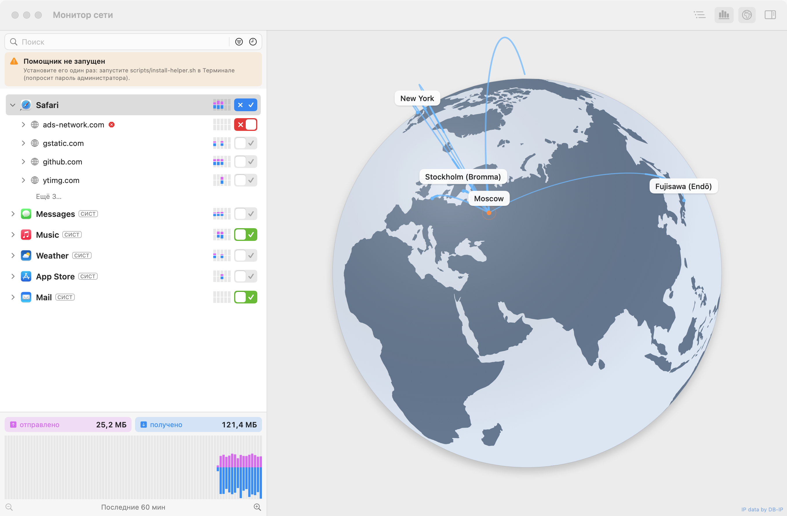

# Noema Snitch

Сетевой монитор и файрвол для macOS в духе Little Snitch, написанный с нуля на Swift/SwiftUI.
Интерфейс на русском и английском (по языку системы). Без платного аккаунта Apple Developer.

A Little Snitch–style network monitor and firewall for macOS, written from scratch in Swift/SwiftUI.
Russian and English UI (follows the system language). No paid Apple Developer account required.



## Возможности

- Окно «Разрешить / Запретить» для каждого нового соединения — до того, как оно установится.
- Правила по приложению, домену (`*.example.com`), хосту, IP и порту; сроки: один раз, до выхода, всегда.
- Монитор сети: приложения → домены → хосты, трафик, график, вращающийся глобус соединений.
- Режимы: запросы, тихий «разрешать», тихий «запрещать».
- Значок в строке меню, одно окно с разделами «Монитор / Правила / Настройки».

## Как это работает

Little Snitch и LuLu используют Network Extension — это требует платного аккаунта Apple.
Noema Snitch вместо этого заворачивает исходящий TCP через `pf` в свой системный помощник (root),
который определяет приложение, читает имя хоста из TLS SNI / HTTP Host и решает, пропустить ли
соединение. Подробности — в [docs/ARCHITECTURE.md](docs/ARCHITECTURE.md).

## Сборка

Нужны Xcode или Command Line Tools (macOS 14+, Apple Silicon).

```bash
./scripts/build-app.sh      # → build/Noema Snitch.app
./scripts/make-dmg.sh       # → build/NoemaSnitch-<version>.dmg
```

Помощник устанавливается из приложения (Настройки → «Сетевой помощник»).
Установка на другой Mac — [docs/INSTALL.txt](docs/INSTALL.txt).

## Данные

- Контуры суши: [Natural Earth](https://www.naturalearthdata.com) (общественное достояние).
- IP-геолокация: [DB-IP](https://db-ip.com) City Lite, CC BY 4.0.
