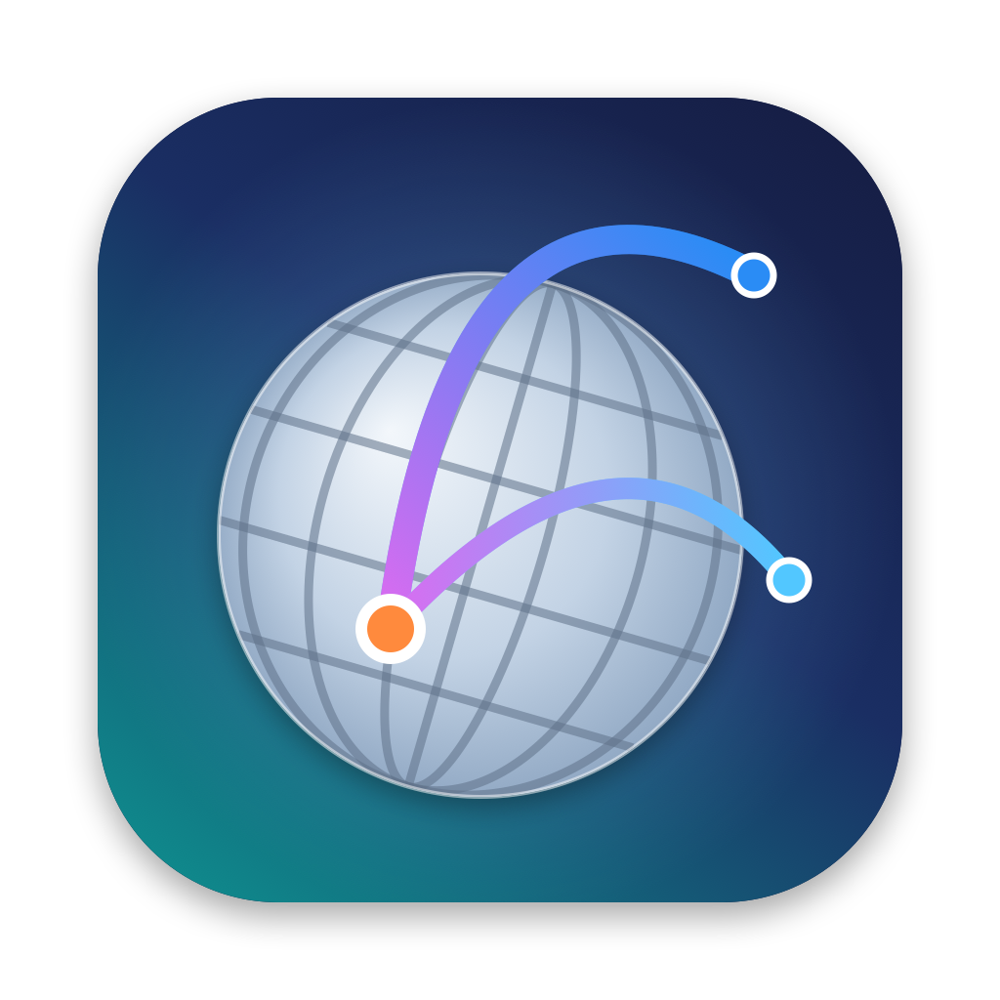
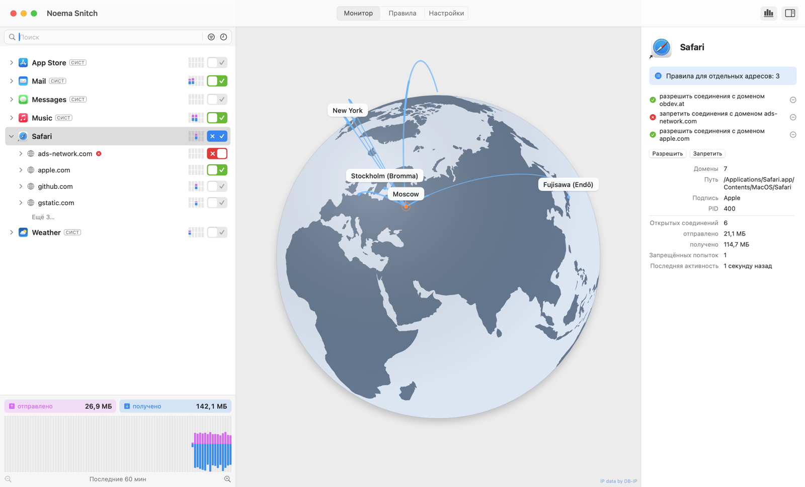
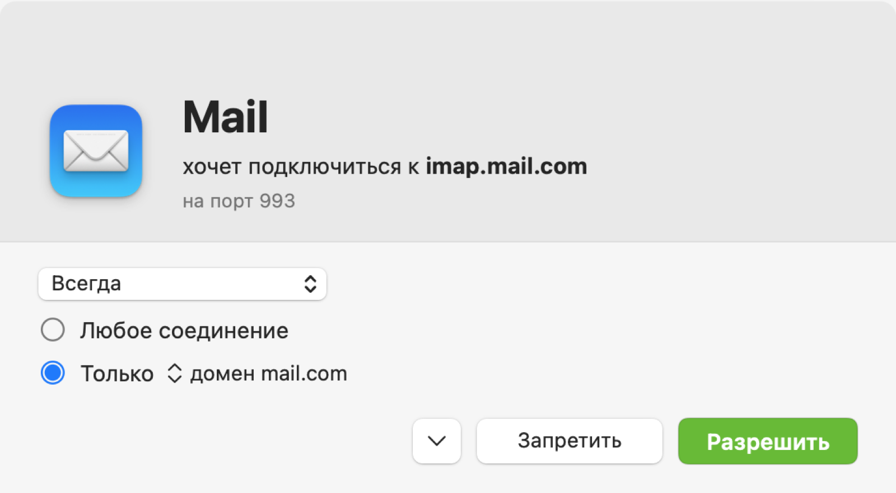
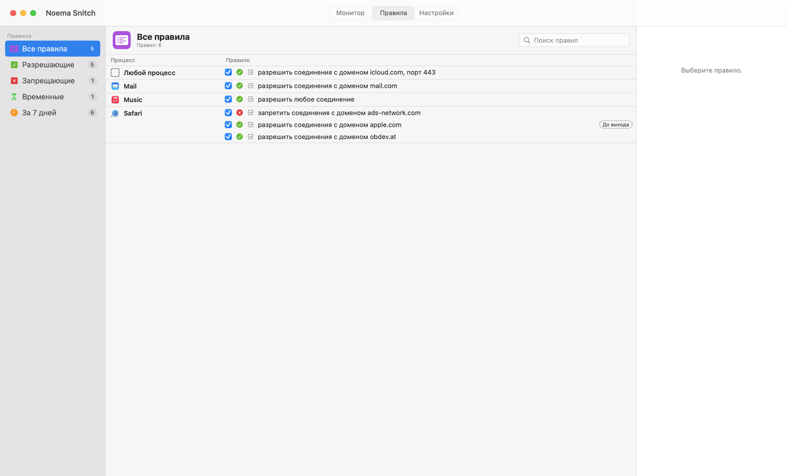
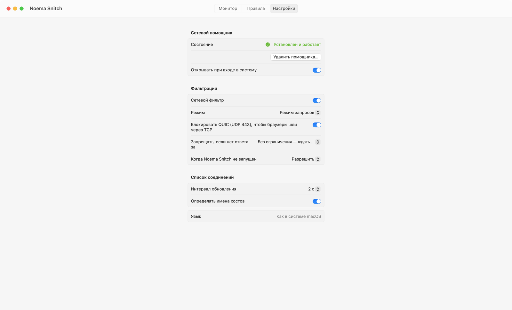

# Noema Snitch

Сетевой монитор и файрвол для macOS в духе Little Snitch, написанный с нуля на Swift/SwiftUI.
Интерфейс на русском и английском (по языку системы). Без платного аккаунта Apple Developer.

A Little Snitch–style network monitor and firewall for macOS, written from scratch in Swift/SwiftUI.
Russian and English UI (follows the system language). No paid Apple Developer account required.



<table>
<tr>
<td width="50%"><br><sub>Запрос на соединение — ждёт вашего ответа</sub></td>
<td width="50%"><br><sub>Правила по процессам</sub></td>
</tr>
<tr>
<td colspan="2"><br><sub>Настройки: помощник, режимы, фильтрация</sub></td>
</tr>
</table>

## Возможности

- Окно «Разрешить / Запретить» для каждого нового соединения — до того, как оно установится.
- Правила по приложению, домену (`*.example.com`), хосту, IP и порту; сроки: один раз, до выхода, всегда.
- Монитор сети: приложения → домены → хосты, трафик, график, вращающийся глобус соединений.
- Режимы: запросы, тихий «разрешать», тихий «запрещать».
- Значок в строке меню, одно окно с разделами «Монитор / Правила / Настройки».

## Как это работает

Little Snitch и LuLu используют Network Extension — это требует платного аккаунта Apple.
Noema Snitch вместо этого заворачивает исходящий TCP через `pf` в свой системный помощник (root),
который определяет приложение, читает имя хоста из TLS SNI / HTTP Host и решает, пропустить ли
соединение. Подробности — в [docs/ARCHITECTURE.md](docs/ARCHITECTURE.md).

## Сборка

Нужны Xcode или Command Line Tools (macOS 14+, Apple Silicon).

```bash
./scripts/build-app.sh      # → build/Noema Snitch.app
./scripts/make-dmg.sh       # → build/NoemaSnitch-<version>.dmg
```

Помощник устанавливается из приложения (Настройки → «Сетевой помощник»).
Установка на другой Mac — [docs/INSTALL.txt](docs/INSTALL.txt).

## Где хранятся настройки и файлы

Само приложение настроек не хранит — его можно копировать или заменять в «Программах»,
правила и настройки сохранятся.

**Общие (помощник, для всех пользователей Mac)** — `/Library/Application Support/NoemaSnitch/`:

| Файл | Что внутри |
|---|---|
| `rules.json` | все постоянные правила «Разрешить / Запретить» |
| `settings.json` | фильтр вкл/выкл, режим, блокировка QUIC, ожидание ответа, «когда приложение не запущено» |

Сам помощник:

| Путь | Назначение |
|---|---|
| `/Library/PrivilegedHelperTools/com.noema.snitch.helper` | программа помощника (root) |
| `/Library/LaunchDaemons/com.noema.snitch.helper.plist` | автозапуск при загрузке Mac |
| `/var/log/noemasnitch.log` | лог |
| группа `_noemasnitch` | помечает собственные соединения помощника, чтобы pf их не перехватывал |

**Личные (у каждого пользователя свои)** — `~/Library/Preferences/com.noema.snitch.plist`:
открытый раздел, вид монитора (график, инспектор, масштаб), интервал обновления,
определение имён хостов, размер окна, список уже виденных приложений.

«Открывать при входе в систему» запоминает конкретную копию приложения: после переноса
в «Программы» выключите и снова включите этот переключатель.

**Удаление:** Настройки → «Удалить помощника…» (правила сохраняются), затем при желании
удалите приложение, `/Library/Application Support/NoemaSnitch/` и
`~/Library/Preferences/com.noema.snitch.plist`.

## Данные

- Контуры суши: [Natural Earth](https://www.naturalearthdata.com) (общественное достояние).
- IP-геолокация: [DB-IP](https://db-ip.com) City Lite, CC BY 4.0.

## Лицензия

Код — [MIT](LICENSE) © 2026 e2ret. Гео-данные в `Resources/Geo` — под своими лицензиями ([подробнее](THIRD_PARTY_NOTICES.md)):
Natural Earth (общественное достояние) и DB-IP (CC BY 4.0, подпись «IP data by DB-IP» обязательна).

Little Snitch — товарный знак Objective Development; Noema Snitch с ним не связан.
